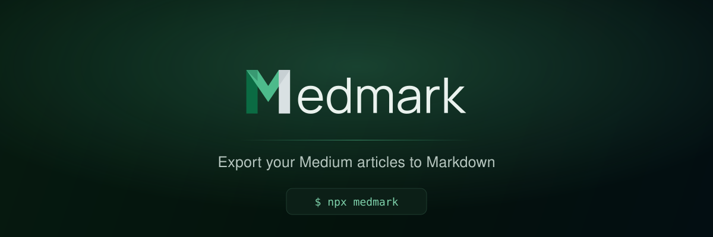

  

  
  
  
  
  <!-- ALL-CONTRIBUTORS-BADGE:START - Do not remove or modify this section -->
  
  <!-- ALL-CONTRIBUTORS-BADGE:END -->
  

  <b>medmark</b> turns a Medium export into clean Markdown or MDX — front matter, images,
  embeds and a content registry — ready for Next.js, Astro, Hugo or anything else.

  <a href="https://brionmario.github.io/medmark/docs"><b>Documentation</b></a> ·
  <a href="https://brionmario.github.io/medmark/docs/getting-started">Getting started</a> ·
  <a href="https://brionmario.github.io/medmark/docs/cli-reference">CLI reference</a> ·
  <a href="https://brionmario.github.io/medmark/docs/agent-skill">Agent skill</a> ·
  <a href="https://brionmario.github.io/medmark/showcase">Showcase</a>

---

## Documentation

Everything lives at **[brionmario.github.io/medmark](https://brionmario.github.io/medmark/docs)**:

|                                                                              |                                                   |
| ---------------------------------------------------------------------------- | ------------------------------------------------- |
| [Getting started](https://brionmario.github.io/medmark/docs/getting-started) | Export your archive and run your first conversion |
| [CLI reference](https://brionmario.github.io/medmark/docs/cli-reference)     | Every command and flag                            |
| [Configuration](https://brionmario.github.io/medmark/docs/configuration)     | Options, image strategies, skips and drafts       |
| [Templates](https://brionmario.github.io/medmark/docs/templates)             | Control the shape of the generated files          |
| [Content registry](https://brionmario.github.io/medmark/docs/registry)       | A manifest of your posts, plus RSS and a sitemap  |
| [Agent skill](https://brionmario.github.io/medmark/docs/agent-skill)         | Let a coding agent convert _and_ host your blog   |
| [Docs for AI](https://brionmario.github.io/medmark/docs/llms)                | `llms.txt` and Markdown copies of every page      |

## For AI agents

medmark ships an [agent skill](https://brionmario.github.io/medmark/docs/agent-skill) for Claude Code, Codex, Cursor and
friends. Installed, it takes the migration end to end — conversion, a blog built from the output, and the deploy. The
skill and its Astro starter live in [`skills/medmark`](./skills/medmark).

## Showcase

Moved your writing across with medmark?
[Add your site to the showcase](https://brionmario.github.io/medmark/docs/showcase) — it's a one-line change to a JSON
file. There's a [badge](https://brionmario.github.io/medmark/docs/showcase#badge) too.

## Contributing

Bug reports, code and documentation improvements are all welcome — see the [contributing guidelines](./CONTRIBUTING.md).

## License

MIT © [Brion Mario](https://github.com/brionmario). See [LICENSE](./LICENSE).
